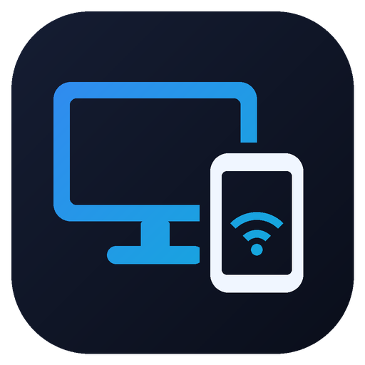

<h1 align="center">DualScreen</h1>

Usa tu teléfono Android <b>u otra PC / notebook</b> como <b>segundo monitor inalámbrico real</b> de Windows 11/10.

DualScreen crea un monitor virtual que Windows trata como una pantalla física (aparece en
**Configuración → Sistema → Pantalla**, se puede extender, reordenar, rotar y arrastrar ventanas hacia él)
y lo transmite al teléfono con codificación por hardware y la menor latencia posible, por Wi‑Fi o desde
otra red.

| Componente | Carpeta | Tecnología |
|---|---|---|
| App de Windows portable (`DualScreen.exe`) | [`windows/`](windows) | C# .NET 8, WPF (estilo Windows 11, Mica), Windows.Graphics.Capture, D3D11, Media Foundation |
| Controlador de pantalla virtual | [`virtual-display-driver/`](virtual-display-driver) | C++ UMDF 2 + IddCx (Indirect Display Driver) |
| App Android (`DualScreen.apk`) | [`android/`](android) | Kotlin, MediaCodec, Camera2 + ZXing, WebRTC |
| Servidor de señalización (opcional, conexión remota) | [`signaling-server/`](signaling-server) | Go + WebSocket, coturn para TURN |
| Protocolo | [`shared/PROTOCOL.md`](shared/PROTOCOL.md) | |
| Actualizaciones y publicación | [`.github/workflows/`](.github/workflows), [`scripts/`](scripts) | GitHub Actions + GitHub Releases |

## Uso rápido

1. Descarga `DualScreen.exe` y `DualScreen.apk` de la página de *Releases*.
2. Ejecuta `DualScreen.exe` (no se instala; queda en el área de notificaciones).
3. Para el **modo extendido**, abre *Configuración → Controlador de pantalla virtual → Instalar* (un único aviso de
   administrador; ver [docs/DRIVER.md](docs/DRIVER.md) sobre la firma del controlador). El **modo espejo** funciona sin controlador.
4. Instala la APK, ábrela y pulsa **Escanear QR** apuntando al código de *Conexión* en el PC.
5. ¿Otra PC o notebook como monitor? Ejecuta `DualScreen.exe` también en ella → **Usar como monitor**, elige el PC y escribe
   su código. Queda guardado y luego se inicia con un clic; su pantalla táctil, lápiz, mouse y teclado controlan el PC.

Guía completa: [docs/USAGE.md](docs/USAGE.md).

## Documentación

- [Arquitectura y decisiones técnicas](docs/ARCHITECTURE.md)
- [Protocolo de comunicación](shared/PROTOCOL.md)
- [Controlador de pantalla virtual: instalación y firma](docs/DRIVER.md)
- [Conexión remota: desplegar señalización y TURN](docs/REMOTE.md)
- [Compilar todo desde cero](docs/BUILD.md)
- [Publicar nuevas versiones](docs/RELEASING.md)
- [Modelo de seguridad](docs/SECURITY.md)

## Estado de verificación

Ser explícitos sobre qué se probó es parte del proyecto. El código se escribió en un entorno Linux sin Windows,
sin WDK y sin Android SDK, así que:

| Parte | Estado |
|---|---|
| Servidor de señalización | ✅ compila; pruebas automáticas (registro firmado, emparejamiento, relé, rechazo de hosts falsos) pasan |
| Núcleo de Windows (protocolo, negociación, bitrate adaptativo, verificación de firmas de actualización) | ✅ compila; 16 pruebas unitarias pasan (las de emparejamiento usan DPAPI y solo se ejecutan en Windows/CI) |
| Capas Windows de captura/codificación/red/controlador (C#) | ✅ compilan contra las API reales (Vortice, SIPSorcery, CsWinRT); ⚠️ sin ejecutar en Windows |
| Interfaz WPF (XAML) | ⚠️ XAML validado y nombres comprobados, pero no compilado (requiere el SDK de escritorio de Windows); lo compila CI |
| App Android (Kotlin) | ✅ compila contra las API del framework Android 15 (AOSP); ⚠️ APK no generada localmente (lo hace CI) ni probada en un dispositivo |
| Controlador IddCx (C++) | ⚠️ no compilado (requiere WDK en Windows; lo compila CI) ni probado |
| Flujos de GitHub Actions | ⚠️ escritos pero no ejecutados (el repositorio aún no está en GitHub) |

La primera ejecución de CI en GitHub es el siguiente paso para validar las partes ⚠️; los errores que aparezcan
deben corregirse puntualmente.

## Licencia

[MIT](LICENSE). La estructura del controlador sigue el *IddSampleDriver* de Microsoft (MIT).
